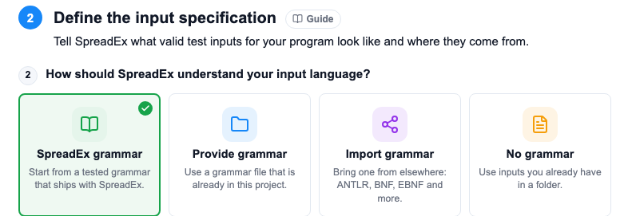
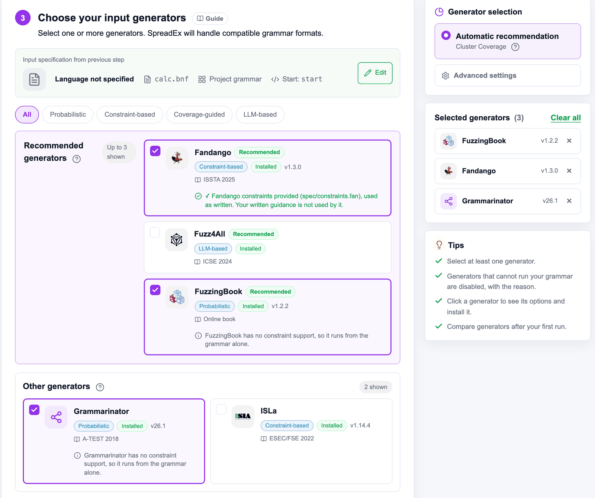
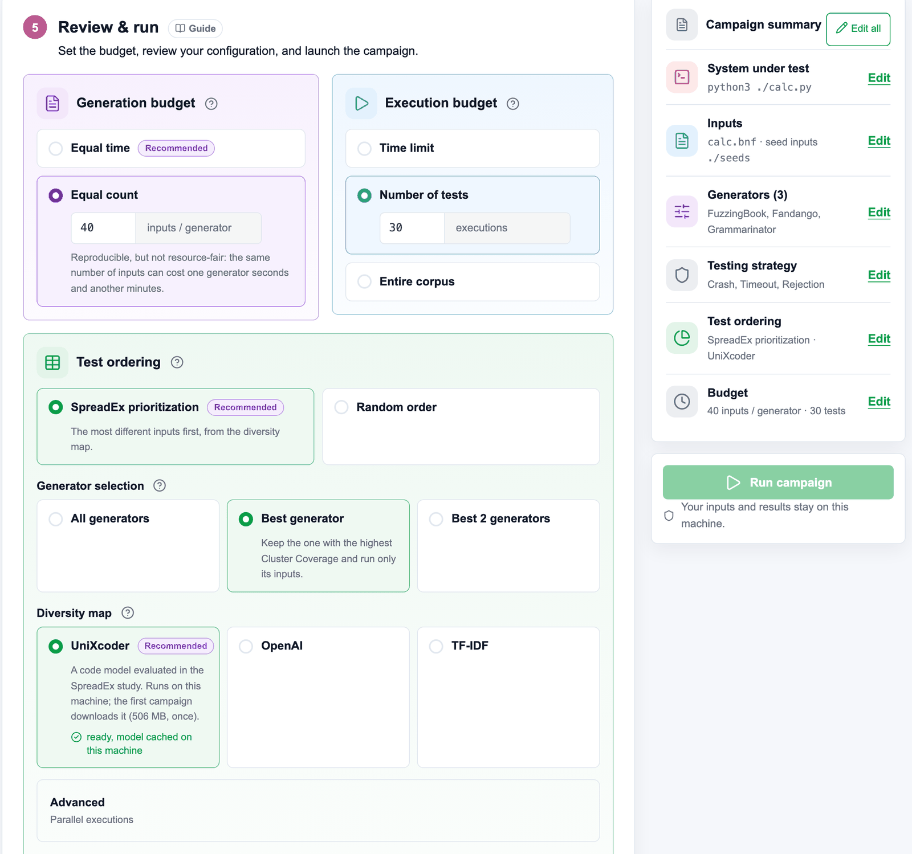
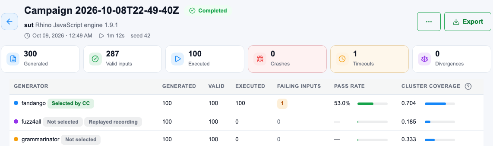

<div align="center">


# SpreadEx

**Run several grammar-based test generators against your program, compare them,<br>and spend a fixed budget on the most diverse inputs first.**

[](https://github.com/ShifatSahariar/SpreadEx/actions/workflows/ci.yml)
[](LICENSE)
[](https://github.com/ShifatSahariar/Embedding-based-Diversity-Mapping)


-ED8B00?style=for-the-badge&logo=openjdk&logoColor=white)


</div>

---

## 🖼️ How it works

**1 · Connect your program**: tell SpreadEx how to run one input; it checks the command first.

<p align="center"></p>

**2 · Give it a grammar**: pick a bundled one, use your own, import ANTLR/BNF/EBNF, or start from existing inputs.

<p align="center"></p>

**3 · Choose generators**: SpreadEx adapts the grammar to each generator and recommends the ones that can run it.

<p align="center"></p>

**4 · Set the budgets and the ordering**: how many inputs each generator makes, how many tests may run, how they are ordered, and which generator's inputs to keep.

<p align="center"></p>

**5 · Compare generators in the campaign**: every generator is scored by Cluster Coverage, and the budget goes to the best one.

<p align="center"></p>

## ✨ What it does

| | |
|---|---|
| 🧬 **Generate** | Fandango, Grammarinator, FuzzingBook and ISLa, each in its own pinned environment, from one grammar or one per generator |
| 🗺️ **Compare** | Embeds every input, clusters them, and scores each generator by **Cluster Coverage** before anything runs |
| 🎯 **Prioritize** | Runs the most diverse inputs first within your time or test budget |
| ⚖️ **Judge** | Separates **crashes**, **timeouts** and **divergences** from inputs your program **correctly rejects** |
| 🔁 **Reproduce** | Every run records its inputs, versions and checksums; findings replay with one click |
| 🖥️ **Workbench** | A five-step local wizard, results views and built-in **Guides** |

## 🚀 Quick start

```bash
pipx install "spreadex[neural] @ git+https://github.com/ShifatSahariar/SpreadEx.git"
```

`[neural]` adds PyTorch for the default UniXcoder diversity map. Without it the install is smaller and campaigns use TF-IDF instead, which every result says.

```bash
spreadex demo          # a real campaign on a small calculator with one real bug
```

Then open the Workbench in your own project:

```bash
cd my-project
spreadex               # the wizard writes spreadex.yaml for you
```

> **Try a real engine:** `spreadex example rhino` sets up the public Rhino 1.9.1 JavaScript engine (downloaded once, SHA-256 verified) with three generators. Needs Java 11+.

## 🧰 Commands

```bash
spreadex init                  # write spreadex.yaml for this project
spreadex doctor                # check the setup; every problem comes with its fix
spreadex generators install fandango grammarinator
spreadex run                   # generate → compare → prioritize → execute → judge
spreadex ui                    # open the Workbench
spreadex results               # how the last campaign went (--all lists them)
spreadex replay <run>          # inspect a past campaign, or --execute it again
spreadex record <run> <gen> -o <dir>   # save a generator's inputs to replay later
spreadex export                # zip the manifest, results and failing inputs
```

<details>
<summary>More commands and flags</summary>

```bash
spreadex example rhino [dir]   # the Rhino showcase project
spreadex runtimes install rhino
spreadex grammar check <file>  # diagnose a grammar; see what each generator supports
spreadex grammar adapt <file>  # derive every generator's dialect
spreadex runs cancel|delete    # manage campaigns
spreadex ui --list | --stop | --read-only

spreadex run --budget 10m -j 8 --selection-signal cc|random --fail-on new-failure
```

The full reference, generated from the CLI itself, is in the Workbench under **Guides → Troubleshooting & CLI**.
</details>

## 🧪 Generators

| Generator | Family | Constraints | Mode |
|---|---|:---:|---|
|  | Constraint-based | ✅ | fresh |
|  | Probabilistic | — | fresh |
|  | Probabilistic | — | fresh |
|  | Constraint-based | ✅ | fresh |
|  | LLM-based | written guidance | authors' artifact (pinned), live with any OpenAI-compatible LLM, or replays a recording |

Installs are deterministic (exact pins, isolated environments, never implicit). Grammars can be BNF, EBNF, ANTLR `.g4`, Fandango or FuzzingBook; SpreadEx converts between them.

### Third-party tools and their licences

SpreadEx is MIT-licensed. It **does not bundle** any generator: each one is downloaded from its official source when you install it, at a pinned version, into its own isolated environment, and keeps its own licence. SpreadEx drives the four grammar-based generators through their published interfaces and **does not modify** them. Fuzz4All is the one exception: it is patched, as explained below.

| Tool | Version | Source | Licence | Modified by SpreadEx? |
|---|---|---|---|---|
| [FuzzingBook](https://www.fuzzingbook.org/) | 1.2.2 | PyPI | MIT | No |
| [Fandango](https://github.com/fandango-fuzzer/fandango) | 1.3.0 | PyPI | EUPL-1.2 | No |
| [Grammarinator](https://github.com/renatahodovan/grammarinator) | 26.1 | PyPI | BSD-3-Clause | No |
| [ISLa](https://github.com/rindPHI/isla) | 1.14.4 | PyPI | GPL-3.0 | No (run as a separate process, never imported) |
| [Fuzz4All](https://github.com/fuzz4all/fuzz4all) | commit `0bf42fe` | GitHub | CC BY 4.0 | **Yes**: a documented patch is applied at install time |
| [UniXcoder](https://huggingface.co/microsoft/unixcoder-base) (embedding model) | `microsoft/unixcoder-base` | Hugging Face | Apache-2.0 | No |
| [Rhino](https://github.com/mozilla/rhino) (example only) | 1.9.1 | Maven Central, SHA-256 verified | MPL-2.0 | No |

**Fuzz4All:** SpreadEx ships a patch (`src/spreadex/generators/patches/fuzz4all/0001-spreadex.patch`), not Fuzz4All itself. The patch adds a chat-completions model backend, autoprompting restored from upstream, usage accounting, and a target that runs candidates through SpreadEx's oracle. CC BY 4.0 permits this with attribution. The patch's SHA-256 is recorded in every installation's receipt. Details and attribution: [THIRD_PARTY_NOTICES.md](THIRD_PARTY_NOTICES.md).

## 🔒 Local-first

Your program, its inputs and every result stay in your project's `.spreadex/` folder. The network is used only when you ask: installing a generator (PyPI), opening the Rhino example (Maven Central), downloading the UniXcoder model once (Hugging Face), choosing OpenAI embeddings (which send every generated input to OpenAI), or the optional, experimental grammar assistant.

```
my-project/
├── spreadex.yaml
└── .spreadex/   corpus.db · blobs/ · runs/<id>/manifest.json
```

## 🧭 Diversity map

Inputs are embedded, clustered once with Affinity Propagation, and that one map gives both Cluster Coverage and the SpreadEx order. Choose the embedding in **Review & run** or with `embedding.model`:

| Model | Runs | Install | Note |
|---|---|---|---|
| `unixcoder` (default) | on this machine | the `[neural]` extra (as in Quick start), then a one-time 506 MB model download | one of the models evaluated in the ICST 2026 study |
| `openai` | at OpenAI | `OPENAI_API_KEY` in the environment | `text-embedding-3-small`, used for the study's prioritization results; sends inputs to OpenAI |
| `tfidf` | on this machine | nothing | character n-grams; not evaluated for fault detection |

If the chosen model cannot run, the campaign falls back (OpenAI → UniXcoder → TF-IDF), says so on the results and records it in the manifest; `embedding.fallback: none` stops instead. Vectors are cached in `.spreadex/embeddings.sqlite`.

## 🎬 Demonstration video

**Video (4:44):** [youtu.be/5-oCDkOGB2Y](https://youtu.be/5-oCDkOGB2Y). It walks through a complete campaign in the Workbench, from setup to findings, replay and CI.

To reproduce the campaign shown in the video (MiniCalc, an illustrative budget of 30 tests):

```bash
spreadex demo --no-run demo-30 && cd demo-30
spreadex run --max-inputs 30 --budget 150s
spreadex ui                    # the same results in the Workbench
```

Expected (deterministic):
- 125 inputs, in 17 clusters;
- Fandango has the highest Cluster Coverage (0.529), so its inputs and the seeds are kept (45);
- the first 30 run, and 2 failure signatures appear, first at inputs 14 and 19, both from the documented modulo-by-zero defect.

`spreadex demo --ui` instead runs every kept input.

## 📄 Research

The algorithms are those of the ICST 2026 paper *Embedding-based Diversity Mapping for Test Generator Selection and Input Prioritization in Grammar-based Testing*. Prioritization follows Algorithm 1 as published (tests derive expected orders from the paper by hand). The paper's replication code orders inputs differently in two places (exemplar choice, closest-first within clusters), and its results come from that code: `prioritization: {variant: replication}` reproduces it, and a CI gate checks that variant against the research code. The published variant does not reproduce the paper's results, and neither variant claims bit-identical reproduction of them. Every campaign records its ordering (`prioritization.json`); `spreadex replay <id> --execute` re-executes a campaign's recorded inputs in their recorded order, and `--regenerate` starts a new campaign instead.
Research code and replication package: **[Embedding-based-Diversity-Mapping](https://github.com/ShifatSahariar/Embedding-based-Diversity-Mapping)** · Artifact: [doi.org/10.5281/zenodo.20071065](https://doi.org/10.5281/zenodo.20071065)

> Cluster Coverage and prioritization are heuristics for spending a budget well; they do not predict faults.

## 🛠️ Development

```bash
pip install -e ".[dev]"
pytest -q -m "not network" --ignore=tests/golden
```

```bash
pip install -e ".[golden]"     # the research-equivalence gate
SPREADEX_REQUIRE_GOLDEN=1 pytest tests/golden -q
```

<details>
<summary>Status and platforms</summary>

**v0.2.0.** Verified from a clean install on **macOS arm64**. **Linux** is partly verified (the Rhino journey on arm64, the demo journeys on x86_64); the unit suite has not yet passed there. **Windows is unverified.** Not yet: coverage collection, regression mode, adaptive allocation, adding your own generator.
</details>

<div align="center"><sub>MIT licensed · Built for grammar-based testing research and practice</sub></div>
